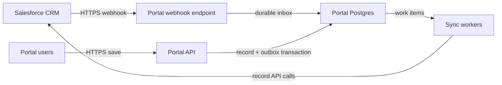

# Two-way sync of customer and contact records

## 1. Assumptions and questions

The assumptions and questions that can change the design are listed in [`decisions.md`](decisions.md). The capacity example below uses a sustained peak of **10 record edits/second**, one Salesforce request per changed record, and a Salesforce query that returns up to **1,000 changed records per page**. The brief does not confirm these values or APIs; confirm them before implementation.

The ordering rule assumes Salesforce event timestamps and portal server timestamps are comparable in UTC. Portal edits also receive a monotonically increasing per-record sequence. If clock skew makes timestamps incomparable, a shared version/precedence contract is needed; the brief does not provide one.

## 2. Systems, boundaries, and interfaces

The Salesforce CRM and Tequity portal are separate systems. The portal owns its Postgres database and the sync worker. Salesforce initiates inbound webhook requests; the portal initiates Salesforce record API requests. Calls to Salesforce, including retries and reconciliation queries, share the 100 requests/second limit.



**Inbound interface:** `POST /webhooks/salesforce` accepts the supplied `eventId`, `recordId`, `objectType`, `occurredAt`, `changedBy`, and `changedFields`. Authenticate the caller using the mechanism Salesforce supports; the exact signature or credential scheme is an open integration question. Validate the object type and allow-listed fields before enqueueing. Return success only after the event is durably recorded, so Salesforce can retry if the portal has not accepted it.

**Portal interface:** the authenticated portal API accepts a record ID, object type, editor identity from the session, and changed fields. The client does not supply the authoritative edit timestamp or sequence; the portal backend creates both when saving.

**Outbound interface:** a worker sends the minimum changed fields to the Salesforce record API through an adapter. The brief does not specify the API path, authentication, conditional update/version support, or response shape; keep those behind the adapter until confirmed. Persist the request, attempt count, and result for recovery and diagnosis.

## 3. Subproblems and build order

| Order | Subproblem | Why it comes here | Component needed |
| --- | --- | --- | --- |
| 1 | Define record identity, field versions, and history | Every later rule depends on what a record and an edit mean. | Postgres schema and version comparator |
| 2 | Accept inbound events durably and only once | Webhook retries and process restarts must not lose an accepted event. | Webhook endpoint and durable inbox |
| 3 | Merge each changed field and retain all changes | Out-of-order events and concurrent edits depend on per-field ordering. | Inbox processor and append-only history |
| 4 | Save portal changes and outbound work atomically | A committed user edit must not disappear before Salesforce is updated. | Portal API and transactional outbox |
| 5 | Deliver outbound calls safely under the cap | Retries, throttling, and outages must preserve work and obey the shared limit. | Outbox worker and shared rate limiter |
| 6 | Identify echoes and reconcile a webhook gap | A loop or an unobserved Salesforce change would invalidate the sync. | Origin check and reconciliation worker |
| 7 | Monitor the 30-second target and recovery | Operators need to see lag before users report stale data. | Queue/API metrics and alerts |

## 4. Data stored

Store only the brief's customer fields (`name`, `status`, `owner`) and contact fields (`fullName`, `phone`, `email`, `city`, `owner`, `customerId`), plus the IDs and metadata needed to sync them.

| Table | Important fields | Purpose |
| --- | --- | --- |
| `sync_record` | `object_type`, `portal_id`, `salesforce_id`, current allowed fields | Current portal view; unique mapping from Salesforce ID to portal ID. |
| `field_version` | record key, field name, winning `source`, `occurred_at`, portal sequence, event ID | Per-field ordering metadata; avoids an old event replacing a newer field. |
| `change_history` | event ID, record key, field, old value, new value, actor, source, source time, received time, applied/current flag | Append-only audit of every distinct valid field change, including a late change that does not win current state. |
| `inbox_event` | event ID, payload/hash, received time, processing state | Deduplicate and recover webhook processing after restart. |
| `outbox_event` | local event ID, record key, changed fields, actor, version, attempts, next attempt, state | Durable Salesforce writes created in the same transaction as a portal save. |
| `sync_cursor` | query cursor or last confirmed Salesforce modification marker | Resume reconciliation after an outage without skipping a page. |

Use a unique constraint on Salesforce event ID and on the Salesforce/portal record mapping. A transaction processes an event's inbox state, per-field updates, and history rows together. Portal save, field versions/history, and its outbox row also commit together. Keep the history immutable and retain it according to an agreed client retention policy; the required retention period is not stated in the brief. Protect personal data with TLS, restricted service access, and encrypted storage according to the hosting platform's controls.

## 5. Inbound path: webhook to portal database

1. Authenticate the webhook, validate required fields/types, and reject unsupported object types or fields. Do not acknowledge malformed or unauthenticated input as accepted.
2. Insert the event in `inbox_event` keyed by Salesforce `eventId`. If that key already exists, return success without applying or auditing the event a second time.
3. After the durable insert, acknowledge the webhook. A worker processes it; request latency does not depend on Salesforce writes.
4. In a database transaction, compare each changed field's version with the stored field version. Write one history row for every distinct valid field change. Update the current field only if this event wins the comparison. Mark the inbox item processed in the same transaction.
5. A worker retry after a crash sees either the committed transaction or an unprocessed inbox item; it does not partially apply an event.

The brief's example contains a changed-field map, so the design treats it as a delta. If Salesforce sends full snapshots, the adapter must identify which fields actually changed and their versions before merging; a full snapshot without field-level versions is not safe to apply over newer portal values.

## 6. Outbound path: portal edit to Salesforce

1. Authenticate the portal user and validate allowed fields. The server supplies actor, UTC timestamp, and per-record sequence.
2. In one Postgres transaction, save the edit, update each affected field version, append history, and insert an outbox event.
3. A worker claims outbox work and calls Salesforce. Use bounded exponential backoff with jitter for transient errors and `Retry-After` for throttling. All attempts consume the same API budget. Never discard pending work on a timeout, restart, or rate limit response.
4. Mark the outbox item delivered only after a confirmed success. A timeout with an unknown remote outcome is retried; the Salesforce update should be idempotent (setting a field to the same value). If Salesforce supports conditional writes or idempotency keys, use them after confirming the API contract.
5. Preserve per-record ordering in the worker: do not send an older queued field version after a newer one. Coalesce unsent updates to different fields of the same record where safe, while retaining every original edit in history.

## 7. Concurrent edits and current-value rule

Compare versions **per field**, not per record, so a change to `phone` does not overwrite an independent change to `city`. The primary order is the source edit timestamp in UTC. Portal timestamps are generated by the server and paired with a monotonically increasing per-record sequence. Salesforce uses `occurredAt` as provided by Salesforce. If timestamps tie, compare a documented stable tuple `(source_rank, source_event_id)` so all workers reach the same result. This tie-break makes the result deterministic; it does not prove which human edit happened last.

For two updates to the same field, the greater version becomes current; both distinct edits remain in `change_history` with actor and source. For edits to different fields, both become current independently. If the timestamp/clock assumption cannot be guaranteed, stop treating last-write-wins as authoritative and agree on a Salesforce record version or a conflict policy with the client. Do not silently overwrite based on webhook arrival order.

## 8. Duplicate and out-of-order events

**Duplicate:** the unique `inbox_event.event_id` makes redelivery a no-op after the first durable acceptance. Return success to stop further retries. History is keyed to the event/field so it is not duplicated.

**Out of order:** suppose field `phone` has a stored version at 11:30:05 and a webhook arrives with `occurredAt` 11:30:04. Record that distinct change in history as late/stale, but do not replace current `phone`. Other fields in that same event are independently compared and may still apply if their versions are newer. Never discard an event just because one of its fields is old.

These rules require a stable event ID and trustworthy source time. The brief's sample provides both, but does not state their formal guarantees; confirm them with the Salesforce integration owner.

## 9. Loop prevention

Outbound updates use a dedicated Salesforce integration identity. When the corresponding webhook arrives, the processor recognizes `changedBy` as that identity, stores the delivery/echo for operational traceability, and does not create another outbound event. Human-originated Salesforce edits continue through the normal merge path.

This rule depends on Salesforce echoing the integration actor in `changedBy`. If it does not, use a Salesforce-supported origin/correlation marker and persist its ID with the outbox event. Do not suppress an event merely because its field value matches a recent outbound value: a human can legitimately set the same value, and value matching alone can hide a real edit. If neither actor nor marker is available, reliable loop prevention is an unresolved integration blocker.

## 10. Six-hour Salesforce outage and recovery arithmetic

Persist the inbox and outbox in Postgres before acknowledging/committing work. During a Salesforce outage, portal edits continue locally and add durable outbox items. Inbound webhooks that never arrive cannot be recovered from the inbox; after Salesforce returns, query Salesforce for records changed since the last confirmed cursor and merge them through the same per-field version/history path. Save each page and its next cursor transactionally. The changed-since query, page size, and cursor guarantees are assumptions requiring confirmation.

**Working estimate:** peak rate = 10 edits/second; outage = 6 hours = 21,600 seconds; one outbound Salesforce request per portal edit; after recovery, reserve 10 requests/second for continuing live edits and target 80 requests/second for outbound work, leaving 20 requests/second of the 100-request cap for reconciliation, retries, and operational headroom.

```text
Portal edits queued during outage = 10 edits/s × 21,600 s = 216,000 edits
Recovery drain after live traffic = 80 requests/s − 10 live requests/s = 70 requests/s
Outbox catch-up = 216,000 requests ÷ 70 requests/s = 3,085.7 s ≈ 51.4 minutes
```

Reconciliation requests also count against the same 100 requests/second cap. If Salesforce changed-since pagination returns 1,000 records per request and 216,000 records changed during the outage, that is about 216 query requests; at the reserved 20 requests/second, about 10.8 seconds of request capacity, plus response processing. This pagination size and API are assumptions, not facts in the brief. Retries, extra API calls per edit, or more than 10 edits/second increase the total. Recalculate using measured calls per edit and observed reconciliation volume before promising a recovery time. If no changed-since query exists, a full scan or another recovery source is required; do not claim the missed events can be reconstructed from webhooks alone.

The 30-second visibility target applies while both systems are up. During the six-hour outage it cannot be met for Salesforce writes; the recovery target is to drain the durable backlog as quickly as the rate limit allows.

## 11. Three numbers to watch

| Metric | Alert threshold | Why |
| --- | --- | --- |
| Oldest unprocessed inbox/outbox age | Warn at 20 seconds; page at 25 seconds while both systems are healthy | Leaves room to act before the 30-second worst-case sync target is missed. Pause this SLO alert during a declared Salesforce outage; keep outage duration visible. |
| Outbox backlog and drain rate | Page if backlog grows for 5 minutes while Salesforce is healthy, or if estimated drain time exceeds 60 minutes after recovery | Shows a worker/capacity problem and tests the recovery estimate against actual traffic. |
| Salesforce API throttles/errors | Page on sustained 429s for 2 minutes or 5xx/error rate above 5% for 5 minutes | Indicates that retries may consume the request budget and threaten freshness or recovery. |

Also log event IDs, record IDs, attempt count, source, and outcome in structured logs; avoid logging contact field values or credentials.

## 12. Out of scope

Deletes, Salesforce login screens, a visual user interface, a second region, and a load test against real Salesforce are excluded this weekend. A production service is not part of this design submission. A fake CRM demo is optional and is not included in this repository.
